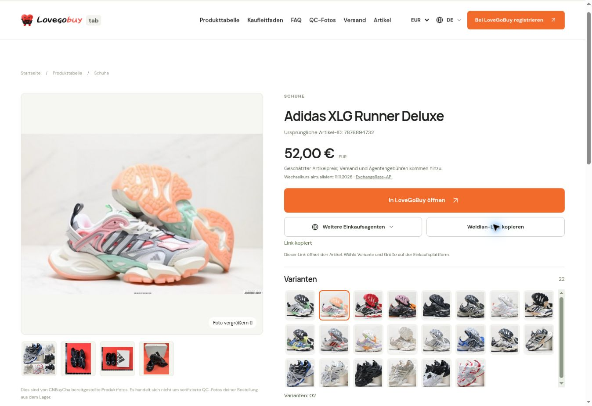

# Product experience validation — 2026-11-11

This change is prepared for review and is not deployed to lovegobuytab.com.

## Behavior

- Product descriptions in headings, cards, image alt text and SEO metadata share a localized 88-term glossary in all 23 non-English locales. Brand and model identifiers remain unchanged. Unrecognized descriptive words retain the source text; this is not unrestricted machine translation.
- Product detail pages use a large gallery beside buying actions and a bounded, scrollable style grid. Mobile stacks these areas without horizontal overflow.
- Styles and CNY prices come from the original Weidian item's public data and are loaded asynchronously. The catalog remains sourced from CNBuyCha. No database is added.
- The global selector supports 28 currencies using daily ExchangeRate-API rates. Stale/unavailable rates fall back to original prices; selected style prices use CNY as their base.
- Other-agent links preserve the verified seller item ID and source referral parameters. Copying returns the original Weidian item URL. Style and size still need selecting on the buying platform.
- The catalog does not supply confirmed per-item QC photos. The QC section displays that limitation instead of labeling ordinary seller photos as QC evidence.

## Validation

- `npm run build` passes.
- `node scripts/check-commerce.mjs` passes: locale/glossary parity, protected names, seller ID and image host checks, style price ranges, currency failure handling, storage failure and clipboard fallback.
- `node scripts/check-editorial-routes.mjs` passes: 384 localized articles, 432 tables, 24 article indexes, 480 sitemap URLs and canonical/hreflang checks.
- `node scripts/check-interaction-events.mjs` passes: seven supported events, no duplicated page views.
- Actual bundled Worker returns HTTP 200 for the same jacket in all 24 languages, with localized headings, 28 currency options and 14 outgoing agent links. The original seller ID remains 7881713873.
- Live seller lookup for shoe item 7876894732 returns 22 style images and CNY prices; all 22 images loaded in the browser.
- Desktop browser checks: selected style 02 updates the main image and displayed EUR price; copy shows success.
- A 390px mobile frame (375px content width after scrollbar) has matching client/scroll widths. Style grid and 14-agent menu are independently scrollable.

The screenshot below is a local preview of actual rendered Worker output using live seller data, not a production screenshot. It shows the German page with EUR selected, style 02 active and successful link copy.

